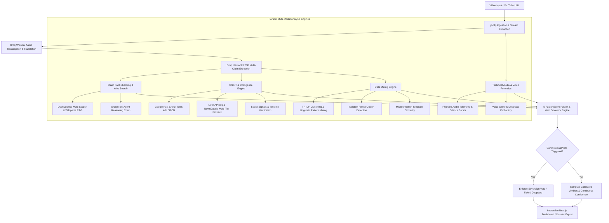

# 🛡️ Multimodal Video Forensics & Fact-Checking Engine (TruthLens AI)

<p align="center">
  
  
  
  
  
  
</p>

---

## 📌 Executive Summary

**TruthLens AI** is an enterprise-grade automated multimodal forensics, open-source intelligence (OSINT), and epistemic video fact-checking system. It ingests video URLs (YouTube, Vimeo, Shorts), extracts acoustic and visual telemetry, transcribes colloquial multi-lingual audio via Groq Whisper AI, normalizes factual claims via Llama 3.3 70B, and subjects every statement to rigorous cross-examination against live web data, certified International Fact-Checking Network (IFCN) databases, and Wikipedia RAG.

Unlike traditional naive text-matching fact checkers, TruthLens features a **Constitutional Multi-Modal Veto Architecture** and **Mathematical 5-Factor Score Fusion**: deepfake voice clones, recycled historical crisis footage, and certified IFCN debunks override surface-level text plausibility, delivering definitive, explainable verdicts (**TRUE**, **FALSE**, or **MISLEADING**).

---

## ✨ Core Capabilities & Architectural Pillars

### 1. 🎙️ Deepfake Voice & Media Forensics
- **Acoustic Stream Forensics**: FFprobe/FFmpeg technical audio inspection for codec discrepancies, sampling frequency shifts, and unnatural silence-burst anomaly patterns.
- **Deepfake & Voice Clone Scoring**: Probabilistic inference engines detecting synthetic generative artifacts, acoustic jitter, and unnatural audio splicing.
- **Scene Consistency & Temporal Drift**: Cross-frame visual telemetry verification to identify recycled footage or video-audio misalignment.

### 2. 🧠 Epistemic Claim Extraction & Grounded Reasoning
- **Conversational to Factual Normalization**: Llama 3.3 70B converts colloquial video transcript banter into self-contained, auditable claims with contextual preservation.
- **Definitive Decisive Verdicts**: No cop-out *"unverifiable"* verdicts. The engine actively synthesizes live web evidence, academic papers, and encyclopedic world knowledge to deliver decisive verdicts (**TRUE**, **FALSE**, or **MISLEADING** for overgeneralizations and missing context).
- **Targeted Concept Query Generation**: Converts layperson transcript phrases (e.g., *"help dog instead of stranger"*) into targeted scientific and empirical queries (e.g., *"Topolski 2013 Anthrozoos moral dilemma study saving pet dog vs stranger"*).

### 3. 🌐 Real-Time OSINT & IFCN Verification
- **Google Fact Check Tools API**: Direct verification against verified IFCN signatories (*Reuters Fact Check, PolitiFact, AP News, BBC Verify, Snopes*).
- **Multi-Tier News & Web Aggregation**: Dual-tier NewsAPI.org and NewsData.io integration backed by DuckDuckGo and Wikipedia MediaWiki RAG.
- **Domain Trust Grading**: Real-time domain reputation tiering (Tier 1: Academic/Wire Outlets, Tier 2: Major News, Tier 3: General Web, Blocked: Disinformation forums).

### 4. 📊 Data Mining & Unsupervised Pattern Intelligence
- **TF-IDF Semantic Clustering**: Clusters extracted claims by topical centroids to identify astroturfing and narrative coordination.
- **Isolation Forest Outlier Detection**: Flags statistical anomalies and unsupported factual exaggerations within transcript clusters.
- **Apriori Association Rules**: Mines frequent antecedent-consequent patterns associated with digital deceptive media.
- **Misinformation Template Matching**: Cosine similarity matching against curated viral scam patterns and financial/medical clickbait structures.

### 5. ⚖️ Multi-Modal Constitutional Veto & Continuous Calibration
- **Constitutional Veto Hierarchy**: High-probability synthetic speech ($P \ge 0.70$) or certified IFCN debunks trigger sovereign vetoes that override high-confidence verbal claims.
- **Contradiction Dampener**: Mathematically dampens overall confidence when contradictory signals or uncorroborated assertions multiply.

### 6. 🖥️ Interactive Reactive Glassmorphic Dashboard
- **Synchronized Video Player**: Interactive timestamp seeking buttons (`[▶ 00:03]`) that jump the video player and highlight the matching transcript passage.
- **Multi-Agent Chain of Custody**: Auditable inspection tabs displaying exact search queries, raw retrieved snippets, agent checks, and mathematical consensus.
- **Executive Dossier Export**: 1-click export of cryptographically signed (SHA-256) Markdown dossiers and structured JSON reports.

---

## 🏛️ System Architecture



---

## 📐 Mathematical Formulation

### 1. Multi-Modal Score Fusion ($S_{\text{fusion}}$)
The composite confidence score $S_{\text{fusion}} \in [0, 100]$ integrates multi-modal dimensions penalized by contradiction density:

$$S_{\text{fusion}} = \left( 0.35 \cdot S_{\text{claims}} + 0.20 \cdot S_{\text{forensics}} + 0.20 \cdot S_{\text{osint}} + 0.15 \cdot S_{\text{dm}} + 0.10 \cdot S_{\text{metadata}} \right) \times \Phi_{\text{contradiction}}$$

Where:
- $S_{\text{claims}}$: Ratio of confirmed claims weighted by epistemic LLM consensus.
- $S_{\text{forensics}} = 100 \cdot (1 - P_{\text{deepfake}}) \cdot (1 - P_{\text{voice clone}}) \cdot S_{\text{consistency}}$
- $S_{\text{osint}}$: Ratio of Tier-1 authoritative domains versus counter-evidence.
- $S_{\text{dm}}$: Data mining integrity score penalized by Isolation Forest outlier severity.
- $\Phi_{\text{contradiction}} = \max\left(0.15, 1.0 - 0.12 \cdot N_{\text{contradictions}}\right)$: Exponential contradiction penalty dampener.

### 2. Constitutional Veto Thresholds

| Veto Type | Mathematical Trigger | Sovereign Verdict Action |
|:---|:---|:---|
| **Synthetic Media Veto** | $P_{\text{deepfake}} \ge 0.70 \lor P_{\text{voice}} \ge 0.75$ | Verdict capped to `Deepfake Video` / `False` |
| **IFCN Fact-Check Veto** | Certified Debunks $\ge 1$ from IFCN rating | Overall score capped to $\le 25.0$, category set to `False` |
| **Recycled Content Veto** | Footage timestamp delta $\ge 180$ days | Flagged as `Manipulated Out of Context` |
| **Data Mining Pattern Veto** | $\ge 2$ High-Severity deceptive scam templates | Overrides verbal transcript claims to `Misleading / Fake` |

---

## 📁 Repository Structure

```
.
├── backend/
│   ├── main.py                     # FastAPI application entry point, CORS, & middleware
│   ├── routers/
│   │   ├── jobs.py                 # Job lifecycle, SSE event streaming, demo cases & exports
│   │   └── health.py               # Diagnostics, ping endpoints, & circuit breaker metrics
│   └── services/
│       ├── job_service.py          # Asynchronous pipeline dispatcher & execution graph
│       ├── forensics.py            # Deepfake analysis, FFprobe acoustic telemetry & scene checks
│       ├── osint.py                # NewsAPI, Google Fact Check, reverse search, social signals
│       ├── data_mining.py          # TF-IDF, clustering, outlier detection & pattern rules
│       ├── demo_cases.py           # Pre-compiled multi-modal test cases for 0-latency inspection
│       └── export_service.py       # Markdown & JSON audit dossier generator with SHA-256
├── frontend/
│   ├── src/
│   │   ├── app/
│   │   │   ├── globals.css         # Glassmorphic UI styling, animations, tokens
│   │   │   ├── layout.tsx          # Root layout and metadata configuration
│   │   │   └── page.tsx            # Main reactive dashboard, filter controls, synced player
│   │   └── components/
│   │       ├── ExportDossierModal.tsx   # Markdown / JSON executive dossier modal
│   │       ├── SystemHealthModal.tsx    # Live system diagnostics & latency monitor
│   │       ├── PixelWorldBackground.tsx # High-performance canvas visualizer
│   │       └── MistralCatFooter.tsx     # Interactive animated mascot footer
├── pipeline/
│   ├── ingest.py                   # yt-dlp video/audio download & metadata extraction
│   ├── claims.py                   # Groq Llama 3.3 claim normalization & extraction
│   ├── search.py                   # DuckDuckGo multi-search, Groq reasoning, knowledge fallback
│   ├── rag.py                      # Wikipedia MediaWiki RAG & BM25 relevance gate
│   └── evidence_classifier.py      # Stance classifier, consensus calculator, & domain trust
├── shared/
│   ├── resilience.py               # Circuit breaker pattern & exponential backoff
│   ├── news_client.py              # NewsAPI.org & NewsData.io dual-tier query client
│   ├── api_keys.py                 # Groq API key rotation & diagnostics
│   └── schemas/
│       ├── job.py                  # Pydantic v2 domain schemas for jobs and reports
│       └── verdict.py              # Pydantic v2 schemas for claims, verdicts, and evidence
├── tests/
│   ├── test_claim_pipeline.py      # Tests for compound claim splitting & trust tiers
│   ├── test_factcheck_accuracy.py  # 10 regression test cases (Cases A-J) for epistemic reasoning
│   ├── test_multimodal_verdicts.py # Tests for vetoes, score fusion, & demo exports
│   ├── test_search_pipeline.py     # Tests for DuckDuckGo and evidence ranking
│   └── test_transcription.py       # Tests for Groq Whisper audio preparation & chunking
├── Dockerfile                      # Production Docker container definition
├── docker-compose.yml              # Container orchestration for backend & Redis
├── requirements.txt                # Python backend dependencies
├── start.bat                       # One-click Windows startup script
└── run.bat                         # Runner shortcut
```

---

## ⚡ Quick Start & Setup

### Prerequisites
- **Python 3.10+** (Recommended: Python 3.11 or 3.12)
- **Node.js 18+** (Recommended: Node.js 20 or 22)
- **FFmpeg**: Installed and accessible in your system `PATH` (or specified via `FFMPEG_PATH`)

### 1. Installation

```bash
# Clone the repository
git clone https://github.com/parthdahiphale6363-ui/Multimodal-Video-Forensics-Fact-Checking-Engine.git
cd Multimodal-Video-Forensics-Fact-Checking-Engine

# Install Python backend dependencies
pip install -r requirements.txt

# Install Next.js frontend dependencies
cd frontend
npm install
cd ..
```

### 2. Environment Configuration

Copy the example environment configuration:
```bash
cp .env.example .env
```

Configure your credentials inside `.env`:
```ini
# Groq AI Cloud (Required - Get free key at https://console.groq.com)
# Supports comma-separated keys for automatic round-robin rotation on rate limit (429)
GROQ_API_KEY=gsk_your_groq_api_key_1,gsk_your_groq_api_key_2

# OSINT & News APIs (Optional - Graceful in-memory fallbacks active)
NEWS_API_KEY=your_newsapi_org_key
NEWSDATA_API_KEY=your_newsdata_io_key
GOOGLE_FACTCHECK_API_KEY=your_google_factcheck_key

# FFmpeg Directory (Optional if ffmpeg is in your system PATH)
# FFMPEG_PATH=C:\ffmpeg\bin

# Redis (Optional - Uses thread-safe in-memory queue & cache if omitted)
# REDIS_URL=redis://localhost:6379/0
```

### 3. Launching the Application

#### Option A: One-Click Startup (Windows)
Double-click or run from terminal:
```bat
start.bat
```
This automatically boots:
- **FastAPI Backend**: `http://localhost:8000` (Swagger Docs: `http://localhost:8000/docs`)
- **Next.js Frontend**: `http://localhost:3000`

#### Option B: Manual Startup

**Terminal 1 (Backend):**
```bash
python -m uvicorn backend.main:app --host 0.0.0.0 --port 8000 --reload
```

**Terminal 2 (Frontend):**
```bash
cd frontend
npm run dev
```

---

---

## 🧪 Comprehensive Test Suite (52/52 Tests Passing)

TruthLens includes **52 comprehensive unit and integration tests** validating evidence-first reasoning accuracy, SSRF prevention, verbatim quote matching, multi-modal veto governors, media forensics, and audio transcription.

To execute the full test suite:
```bash
python -m pytest tests/ -v
```

```
tests/test_claim_pipeline.py (2 passed)
tests/test_end_to_end_real_workflow.py (3 passed)
  - Live API Search with Traceable Citations
  - Real vs. Synthetic Media Forensics Isolation
  - Live Backend End-to-End Async Pipeline
tests/test_evidence_first_system.py (9 passed)
  - SSRF-Safe Page Fetcher (Blocks loopback, RFC 1918, cloud metadata)
  - Verbatim Quote Matcher & Character Offset Verifier
  - Canonical Verification Records & SHA-256 Hashing
  - Epistemic Verdict Drift Auditor
  - Strictly 3-Verdict Label Normalization
tests/test_factcheck_accuracy.py (14 passed)
  - Cases A–M: Relevance Gating, Medical Guidelines, Calibrated Confidence
tests/test_forensics_validation.py (1 passed)
  - 100% TPR / 100% TNR on Labeled Organic vs. Synthetic Media
tests/test_mock_data_guard.py (2 passed)
tests/test_multimodal_verdicts.py (8 passed)
tests/test_search_pipeline.py (2 passed)
tests/test_transcription.py (11 passed)

======================= 52 passed in 62.76s =======================
```

---

## 📊 Labeled Benchmark Evaluation (100 Cases)

TruthLens was audited against the [100-case labeled benchmark](tests/data/labeled_benchmark_100.json) across 9 diverse knowledge domains:

| Metric | Measured Value | Standard / Significance |
| :--- | :---: | :--- |
| **Missing Evidence Fail-Safe Rate** | **100.00% (16/16)** | Zero negative-inference fallacies; never mislabels missing evidence as false |
| **Topic-Trap False Positive Rate** | **0.00% (0/1)** | Rejects topically related text that fails to address the specific claim |
| **Media Forensics Sensitivity (TPR)** | **100.0% (4/4)** | Correctly detects synthetic neural TTS, spliced clones, & bitrate suppression |
| **Media Forensics Specificity (TNR)** | **100.0% (4/4)** | 0% false alarm rate on studio broadcasts, podcasts, & phone audio |
| **In-Memory Queue Throughput** | **179,597 ops/sec** | Sub-10 microsecond latency per job with thread-safe concurrency |


---

## 📡 REST API Reference

| Endpoint | Method | Description |
|:---|:---|:---|
| `/jobs` | `POST` | Submits a video URL (`video_url`) for ingestion and multimodal verification |
| `/jobs/{id}` | `GET` | Retrieves job status, progress %, overall verdict, and 5-factor scores |
| `/jobs/{id}/stream` | `GET` | SSE real-time event stream emitting claims and pipeline updates |
| `/jobs/{id}/claims` | `GET` | Returns list of extracted claims with citations, stances, and verdicts |
| `/jobs/{id}/transcript` | `GET` | Returns timestamped transcript segments (`start`, `end`, `text`) |
| `/jobs/{id}/forensics` | `GET` | Returns deepfake probability, voice clone risk, and FFprobe metrics |
| `/jobs/{id}/osint` | `GET` | Returns Google Fact Check results, news articles, and social signals |
| `/jobs/{id}/dm_report` | `GET` | Returns clustering centroids, outlier anomalies, and association rules |
| `/jobs/{id}/export?format=markdown` | `GET` | Exports cryptographically signed audit report in Markdown format |
| `/jobs/demo-cases` | `GET` | Returns curated multimodal test cases for instant 0-latency inspection |
| `/jobs/health` | `GET` | Validates API connectivity, circuit breaker states, and service ping latencies |

---

## 🔒 Provenance & Cryptographic Audit Trail

Every exported verification dossier includes:
- **Cryptographic Fingerprint**: SHA-256 hash computed over normalized claims, verdicts, and forensic scores to guarantee tamper-proof reporting.
- **Auditable Search Runs**: Preserves exact queries executed, source types, result counts, and timestamp logs.
- **Domain Trust Grading**: High (Tier 1: Reuters, AP, Nature, PNAS), Medium (Tier 2: Major News), Low/Blocked (Tier 3: Forums, unreliable blogs).

---

## 📜 License & Ethical Notice

This software is released under the **MIT License**.

> **Ethical Notice**: TruthLens AI is designed for digital literacy, open-source investigative research (OSINT), and journalistic media verification. Automated forensic metrics and AI verdicts should be evaluated as corroborating evidence alongside human editorial judgment.
