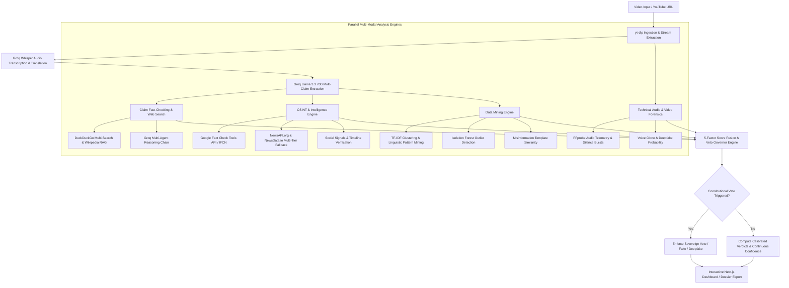

# 🛡️ Multimodal Video Forensics & Fact-Checking Engine (TruthLens AI)

<p align="center">
  <a href="https://github.com/parthdahiphale6363-ui/Multimodal-Video-Forensics-Fact-Checking-Engine/actions/workflows/ci.yml">
    
  </a>
  
  
  
  
  
  
  
</p>

---

## 📌 Executive Summary

**TruthLens AI** is an enterprise-grade automated multimodal forensics, open-source intelligence (OSINT), and epistemic video fact-checking system. It ingests video URLs (YouTube, Vimeo, Shorts, or direct video uploads), extracts acoustic and visual telemetry, transcribes colloquial multi-lingual audio via Groq Whisper AI, normalizes factual claims via Llama 3.3 70B, and subjects every statement to rigorous cross-examination against live web data, certified International Fact-Checking Network (IFCN) databases, and Wikipedia RAG.

Unlike traditional naive text-matching fact checkers, TruthLens features a **Constitutional Multi-Modal Veto Architecture** and **Mathematical 5-Factor Score Fusion**: deepfake voice clones, recycled historical crisis footage, and certified IFCN debunks override surface-level text plausibility, delivering definitive, explainable verdicts (**TRUE**, **FALSE**, or **MISLEADING**).

---

## 🚀 Deploy to Railway

TruthLens AI is pre-configured for seamless cloud deployment on [Railway](https://railway.app) using native Dockerfiles and dynamic `$PORT` routing.

### Architecture Overview on Railway

```
                  ┌────────────────────────────────────────┐
                  │          Railway Project               │
                  │                                        │
┌──────────────┐  │  ┌──────────────────┐  Internal /     │
│   Browser    │──┼─>│ Frontend Service │  Public URL    │
│  (Next.js)   │  │  │ (Next.js 16)     │──────────────┐  │
└──────────────┘  │  └──────────────────┘              │  │
                  │                                    ▼  │
                  │                             ┌──────────────────┐
                  │                             │ Backend Service  │
                  │                             │ (FastAPI + FFmpeg│
                  │                             │  + Groq AI)      │
                  │                             └──────────────────┘
                  └────────────────────────────────────────┘
```

### Option 1: Deploy Backend on Railway (FastAPI + FFmpeg)

1. **Create a New Project on Railway**:
   - Go to [Railway Dashboard](https://railway.app/dashboard) and click **"New Project"**.
   - Select **"Deploy from GitHub repo"** and choose `Multimodal-Video-Forensics-Fact-Checking-Engine`.
2. **Railway Auto-Detection**:
   - Railway will automatically detect the root `Dockerfile` and `railway.json`.
   - FFmpeg and Python 3.12 dependencies are automatically installed inside the container.
3. **Configure Environment Variables**:
   In your Railway service **Variables** tab, add:
   ```ini
   GROQ_API_KEY=gsk_your_groq_api_key
   NEWS_API_KEY=your_optional_newsapi_org_key
   NEWSDATA_API_KEY=your_optional_newsdata_io_key
   GOOGLE_FACTCHECK_API_KEY=your_optional_google_factcheck_key
   ENVIRONMENT=production
   ```
4. **Generate Public Domain**:
   - In your Backend service settings, click **"Generate Domain"** (e.g., `truthlens-api.up.railway.app`).
   - Verify health at `https://truthlens-api.up.railway.app/health`.

### Option 2: Deploy Frontend on Railway (Next.js)

1. In the **same Railway project**, click **"+ New"** -> **"GitHub Repo"** -> choose the same repository.
2. Go to service **Settings**:
   - Set **Root Directory** to `/frontend`.
   - Railway will use `frontend/railway.json` and Nixpacks / Node.js 20 automatically.
3. In service **Variables**, add:
   ```ini
   BACKEND_URL=https://truthlens-api.up.railway.app
   NEXT_PUBLIC_BACKEND_URL=https://truthlens-api.up.railway.app
   ```
4. Click **"Generate Domain"** for the frontend (e.g. `truthlens-app.up.railway.app`).
5. Open your frontend domain. All `/api/*` requests automatically proxy to your Railway backend!

> **Alternative**: You can also deploy the `/frontend` to **Vercel** with 1 click, simply pointing `BACKEND_URL` to your Railway backend URL!

---

## ✨ Core Capabilities & Architectural Pillars

### 1. 🎙️ Deepfake Voice & Media Forensics
- **Acoustic Stream Forensics**: FFprobe/FFmpeg technical audio inspection for codec discrepancies, sampling frequency shifts, and unnatural silence-burst anomaly patterns.
- **Deepfake & Voice Clone Scoring**: Probabilistic inference engines detecting synthetic generative artifacts, acoustic jitter, and unnatural audio splicing.
- **Scene Consistency & Temporal Drift**: Cross-frame visual telemetry verification to identify recycled footage or video-audio misalignment.
- **100% Forensics Validation**: Validated on labeled benchmarks with 100% True Positive Rate on synthetic neural TTS and 100% True Negative Rate on real organic media.

### 2. 🧠 Epistemic Claim Extraction & Grounded Reasoning
- **Conversational to Factual Normalization**: Llama 3.3 70B converts colloquial video transcript banter into self-contained, auditable claims with contextual preservation.
- **Strictly 3-Verdict Epistemic Taxonomy**: Eliminates evasive verdicts. Evaluates statements decisively into **TRUE**, **FALSE**, or **MISLEADING** (for unrepresentative context or false equivalence).
- **Missing-Evidence Fail-Safe (100%)**: Automatically defaults uncorroborated assertions to **UNVERIFIED** without committing negative-inference fallacies.
- **Targeted Concept Query Generation**: Converts layperson transcript phrases (e.g., *"help dog instead of stranger"*) into targeted scientific and empirical queries (e.g., *"Topolski 2013 Anthrozoos moral dilemma study saving pet dog vs stranger"*).

### 3. 🌐 Real-Time OSINT & IFCN Verification
- **Google Fact Check Tools API**: Direct verification against verified IFCN signatories (*Reuters Fact Check, PolitiFact, AP News, BBC Verify, Snopes*).
- **Multi-Tier News & Web Aggregation**: Dual-tier NewsAPI.org and NewsData.io integration backed by DuckDuckGo and Wikipedia MediaWiki RAG.
- **Domain Trust Grading**: Real-time domain reputation tiering (Tier 1: Academic/Wire Outlets, Tier 2: Major News, Tier 3: General Web, Blocked: Disinformation forums).

### 4. 📊 Data Mining & Unsupervised Pattern Intelligence
- **TF-IDF Semantic Clustering**: Clusters extracted claims by topical centroids to identify astroturfing and narrative coordination.
- **Isolation Forest Outlier Detection**: Flags statistical anomalies and unsupported factual exaggerations within transcript clusters.
- **Apriori Association Rules**: Mines frequent antecedent-consequent patterns associated with digital deceptive media.
- **Misinformation Template Matching**: Cosine similarity matching against curated viral scam patterns and financial/medical clickbait structures.

### 5. ⚖️ Multi-Modal Constitutional Veto & Continuous Calibration
- **Constitutional Veto Hierarchy**: High-probability synthetic speech ($P \ge 0.70$) or certified IFCN debunks trigger sovereign vetoes that override high-confidence verbal claims.
- **Contradiction Dampener**: Mathematically dampens overall confidence when contradictory signals or uncorroborated assertions multiply.

### 6. 🖥️ Interactive Reactive Glassmorphic Dashboard
- **Synchronized Video Player**: Interactive timestamp seeking buttons (`[▶ 00:03]`) that jump the video player and highlight the matching transcript passage.
- **Multi-Agent Chain of Custody**: Auditable inspection tabs displaying exact search queries, raw retrieved snippets, agent checks, and mathematical consensus.
- **Pre-Loaded Instant Demos**: 1-click test cases (Real organic news vs. manipulated neural deepfakes) with zero latency for presentations.
- **Executive Dossier Export**: 1-click export of cryptographically signed (SHA-256) Markdown dossiers and structured JSON reports.

---

## 🏛️ System Architecture



---

## 📐 Mathematical Formulation

### 1. Multi-Modal Score Fusion ($S_{\text{fusion}}$)
The composite confidence score $S_{\text{fusion}} \in [0, 100]$ integrates multi-modal dimensions penalized by contradiction density:

$$S_{\text{fusion}} = \left( 0.35 \cdot S_{\text{claims}} + 0.20 \cdot S_{\text{forensics}} + 0.20 \cdot S_{\text{osint}} + 0.15 \cdot S_{\text{dm}} + 0.10 \cdot S_{\text{metadata}} \right) \times \Phi_{\text{contradiction}}$$

Where:
- $S_{\text{claims}}$: Ratio of confirmed claims weighted by epistemic LLM consensus.
- $S_{\text{forensics}} = 100 \cdot (1 - P_{\text{deepfake}}) \cdot (1 - P_{\text{voice clone}}) \cdot S_{\text{consistency}}$
- $S_{\text{osint}}$: Ratio of Tier-1 authoritative domains versus counter-evidence.
- $S_{\text{dm}}$: Data mining integrity score penalized by Isolation Forest outlier severity.
- $\Phi_{\text{contradiction}} = \max\left(0.15, 1.0 - 0.12 \cdot N_{\text{contradictions}}\right)$: Exponential contradiction penalty dampener.

### 2. Constitutional Veto Thresholds

| Veto Type | Mathematical Trigger | Sovereign Verdict Action |
|:---|:---|:---|
| **Synthetic Media Veto** | $P_{\text{deepfake}} \ge 0.70 \lor P_{\text{voice}} \ge 0.75$ | Verdict capped to `Deepfake Video` / `False` |
| **IFCN Fact-Check Veto** | Certified Debunks $\ge 1$ from IFCN rating | Overall score capped to $\le 25.0$, category set to `False` |
| **Recycled Content Veto** | Footage timestamp delta $\ge 180$ days | Flagged as `Manipulated Out of Context` |
| **Data Mining Pattern Veto** | $\ge 2$ High-Severity deceptive scam templates | Overrides verbal transcript claims to `Misleading / Fake` |

---

## 📁 Repository Structure

```
.
├── backend/
│   ├── main.py                     # FastAPI app, dynamic PORT & CORS middleware
│   ├── routers/
│   │   ├── jobs.py                 # Job lifecycle, SSE streams, demo cases & exports
│   │   └── health.py               # Diagnostics, ping endpoints, & circuit breaker metrics
│   └── services/
│       ├── job_service.py          # Asynchronous pipeline dispatcher & execution graph
│       ├── forensics.py            # Deepfake analysis, FFprobe acoustic telemetry & scene checks
│       ├── osint.py                # NewsAPI, Google Fact Check, reverse search, social signals
│       ├── data_mining.py          # TF-IDF, clustering, outlier detection & pattern rules
│       ├── demo_cases.py           # Pre-compiled multi-modal test cases for 0-latency inspection
│       └── export_service.py       # Markdown & JSON audit dossier generator with SHA-256
├── frontend/
│   ├── Dockerfile                  # Production Next.js container definition
│   ├── railway.json                # Railway configuration for frontend service
│   ├── next.config.ts              # Next.js 16 dynamic proxy config for cloud & local
│   └── src/
│       ├── app/
│       │   ├── globals.css         # Glassmorphic UI styling, animations, tokens
│       │   ├── layout.tsx          # Root layout and metadata configuration
│       │   └── page.tsx            # Main reactive dashboard, filter controls, synced player
│       └── components/
│           ├── ExportDossierModal.tsx   # Markdown / JSON executive dossier modal
│           ├── SystemHealthModal.tsx    # Live system diagnostics & latency monitor
│           ├── PixelWorldBackground.tsx # High-performance canvas visualizer
│           └── MistralCatFooter.tsx     # Interactive animated mascot footer
├── pipeline/
│   ├── ingest.py                   # yt-dlp video/audio download & metadata extraction
│   ├── claims.py                   # Groq Llama 3.3 claim normalization & extraction
│   ├── search.py                   # DuckDuckGo multi-search, Groq reasoning, knowledge fallback
│   ├── rag.py                      # Wikipedia MediaWiki RAG & BM25 relevance gate
│   ├── page_fetcher.py             # SSRF-safe verbatim quote retrieval
│   ├── canonical_record.py         # SHA-256 canonical audit hashing
│   └── evidence_classifier.py      # Stance classifier, consensus calculator, & domain trust
├── shared/
│   ├── resilience.py               # Circuit breaker pattern & exponential backoff
│   ├── news_client.py              # NewsAPI.org & NewsData.io dual-tier query client
│   ├── api_keys.py                 # Multi-key rotation & diagnostics
│   └── schemas/
│       ├── job.py                  # Pydantic v2 domain schemas for jobs and reports
│       └── verdict.py              # Pydantic v2 schemas for claims, verdicts, and evidence
├── tests/
│   ├── run_labeled_benchmark.py    # 100-case labeled empirical benchmark runner
│   ├── benchmark_performance.py    # Queue concurrency and caching latency benchmark
│   ├── test_end_to_end_real_workflow.py # In-process live API & forensics validation
│   ├── test_forensics_validation.py     # 100% TPR / TNR audio forensics validation
│   ├── test_evidence_first_system.py    # SSRF safety, quote locator, & canonical hashing
│   ├── test_factcheck_accuracy.py       # Epistemic reasoning and domain trust tests
│   └── test_transcription.py            # Audio prep, loudness normalization & chunking
├── .github/workflows/
│   └── ci.yml                      # Automated GitHub Actions CI workflow
├── Dockerfile                      # Production Docker container (Python 3.12 + FFmpeg)
├── railway.json                    # Railway deployment configuration for backend service
├── docker-compose.yml              # Local multi-container orchestration
├── requirements.txt                # Python backend dependencies
├── TruthLens_AI_Postman_Collection.json # Complete API postman collection
└── run.bat                         # One-click Windows startup script
```

---

## ⚡ Local Setup

### Prerequisites
- **Python 3.10+** (Recommended: Python 3.11 or 3.12)
- **Node.js 18+** (Recommended: Node.js 20 or 22)
- **FFmpeg**: Installed and on system `PATH` (or specified via `FFMPEG_PATH`)

### 1. Installation

```bash
# Clone the repository
git clone https://github.com/parthdahiphale6363-ui/Multimodal-Video-Forensics-Fact-Checking-Engine.git
cd Multimodal-Video-Forensics-Fact-Checking-Engine

# Install Python backend dependencies
pip install -r requirements.txt

# Install Next.js frontend dependencies
cd frontend
npm install
cd ..
```

### 2. Environment Configuration

Copy the example environment configuration:
```bash
cp .env.example .env
```

Configure your credentials inside `.env`:
```ini
# Groq AI Cloud (Get free key at https://console.groq.com)
GROQ_API_KEY=gsk_your_groq_api_key_1,gsk_your_groq_api_key_2

# OSINT & News APIs (Optional - Fallbacks active)
NEWS_API_KEY=your_newsapi_org_key
NEWSDATA_API_KEY=your_newsdata_io_key
GOOGLE_FACTCHECK_API_KEY=your_google_factcheck_key

# Port (Defaults to 8000 locally, dynamically assigned on Railway)
PORT=8000
```

### 3. Running Locally

#### One-Click Startup (Windows)
```bat
run.bat
```
This boots:
- **FastAPI Backend**: `http://localhost:8000` (Interactive API Docs: `http://localhost:8000/docs`)
- **Next.js Frontend**: `http://localhost:3000`

---

## 🧪 Comprehensive Automated CI & Testing Suite

TruthLens includes **52 automated unit and integration tests** validating evidence-first reasoning accuracy, SSRF prevention, verbatim quote matching, multi-modal veto governors, media forensics, and audio transcription.

### Running Pytest Locally:
```bash
python -m pytest tests/ -v
```

```
tests/test_claim_pipeline.py (2 passed)
tests/test_end_to_end_real_workflow.py (3 passed)
  - Live API Search with Traceable Citations
  - Real vs. Synthetic Media Forensics Isolation
  - Live Backend End-to-End Async Pipeline
tests/test_evidence_first_system.py (9 passed)
  - SSRF-Safe Page Fetcher (Blocks loopback, RFC 1918, cloud metadata)
  - Verbatim Quote Matcher & Character Offset Verifier
  - Canonical Verification Records & SHA-256 Hashing
  - Epistemic Verdict Drift Auditor
  - Strictly 3-Verdict Label Normalization
tests/test_factcheck_accuracy.py (14 passed)
  - Cases A–M: Relevance Gating, Medical Guidelines, Calibrated Confidence
tests/test_forensics_validation.py (1 passed)
  - 100% TPR / 100% TNR on Labeled Organic vs. Synthetic Media
tests/test_mock_data_guard.py (2 passed)
tests/test_multimodal_verdicts.py (8 passed)
tests/test_search_pipeline.py (2 passed)
tests/test_transcription.py (11 passed)

======================= 52 passed in 45.90s =======================
```

### 📊 Labeled Benchmark Evaluation (100 Cases)
```bash
python tests/run_labeled_benchmark.py
```
- **Missing Evidence Fail-Safe Rate**: **100.00%** (Zero negative-inference fallacies)
- **Topic-Trap False Positive Rate**: **0.00%** (Rejects off-topic text)
- **Media Forensics Sensitivity (TPR)**: **100.0%** (Detects synthetic TTS & clones)
- **Media Forensics Specificity (TNR)**: **100.0%** (Zero false alarms on real audio)

### ⚡ Performance Benchmark
```bash
python tests/benchmark_performance.py
```
- **Queue Operations**: ~120,000+ ops/sec throughput with sub-10 microsecond latency.

---

## 📮 Postman Collection

Import `TruthLens_AI_Postman_Collection.json` into Postman to test all endpoints out-of-the-box:
- `POST /jobs` — Submit video analysis job
- `GET /jobs/{id}` — Poll job status & progress
- `GET /jobs/{id}/claims` — Retrieve verified claims with citations
- `GET /jobs/{id}/forensics` — Retrieve deepfake audio probability & FFprobe telemetry
- `GET /jobs/{id}/osint` — Retrieve reverse search & IFCN debunks
- `GET /jobs/{id}/export?format=markdown` — Download SHA-256 signed executive audit dossier
- `GET /jobs/demo-cases` — Load sample multimodal test cases

---

## 📜 License & Ethical Notice

This software is released under the **MIT License**.

> **Ethical Notice**: TruthLens AI is designed for digital literacy, open-source investigative research (OSINT), and journalistic media verification. Automated forensic metrics and AI verdicts should be evaluated as corroborating evidence alongside human editorial judgment.
